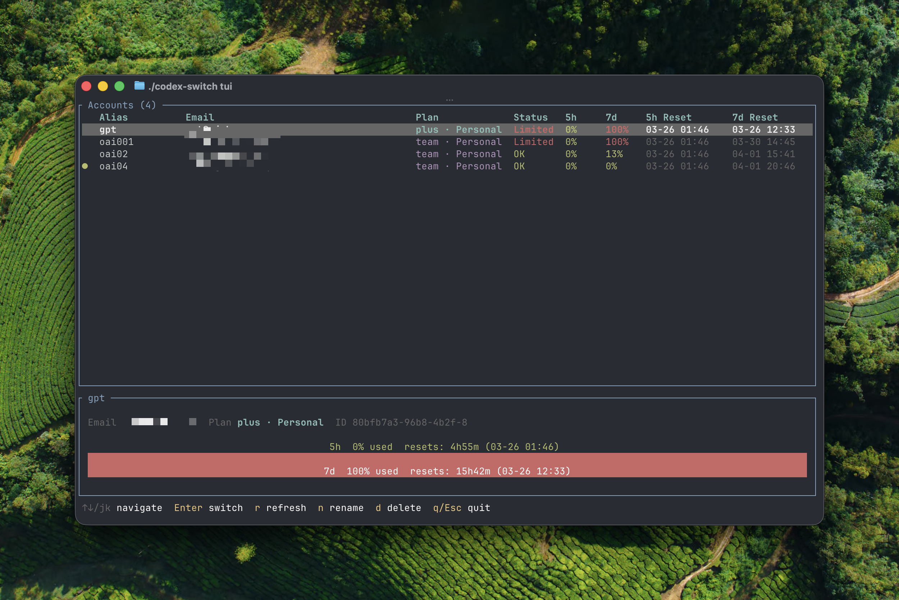

# codex-switch

**A multi-account manager for [OpenAI Codex](https://github.com/openai/codex), including file-backed desktop logins.** Save local Codex logins, monitor quota, and select the best account before the next session.

[中文说明](README_CN.md) · [**Documentation (Wiki)**](https://github.com/xjoker/codex-switch/wiki) · [Releases](https://github.com/xjoker/codex-switch/releases)



> `codex-switch` manages local authentication files. Never publish profiles, `auth.json`, tokens, proxy credentials, or unredacted debug output.

## Quick start

No Codex CLI or desktop installation is needed for account management and the TUI. When sharing credentials with Codex, use its file credential store. If needed, add this to `$CODEX_HOME/config.toml` (normally `~/.codex/config.toml`); a managed configuration with `forced_login_method = "api"` is incompatible:

```toml
cli_auth_credentials_store = "file"
```

Install the stable release — macOS / Linux:

```bash
curl -fsSL https://github.com/xjoker/codex-switch/releases/latest/download/install.sh | bash
```

Windows PowerShell:

```powershell
irm https://github.com/xjoker/codex-switch/releases/latest/download/install.ps1 | iex
```

Homebrew users: `brew install xjoker/tap/codex-switch`.

> **Note:** this project is not distributed on crates.io — do not `cargo install codex-switch`; that package name belongs to an unrelated project.

Then add an account and open the dashboard:

```bash
codex-switch login        # use --device on a headless machine
codex-switch tui          # interactive dashboard
codex-switch use          # switch to the best eligible account
codex-switch launch       # start Codex with the best account
```

Login, account management, quota/subscription/Daybreak queries and the TUI work without installing either the CLI or the desktop app. Only `launch` needs a Codex engine. On macOS, it also discovers the engine bundled with ChatGPT or Codex in the user's or system Applications folder when no PATH CLI is available. Set `CODEX_SWITCH_CODEX` to an executable path for another installation or to select a specific engine. `launch` starts that engine in the terminal; it does not open the desktop GUI.

Run `codex-switch doctor` to inspect engine selection; `--desktop-codex <path>` also checks a specific bundled engine. The support minimum remains 0.159.2; versions newer than the 0.162.1 alignment baseline are accepted but not fully verified. ChatGPT account management requires `cli_auth_credentials_store = "file"`; keyring, auto and ephemeral stores are unsupported. After switching, reconnect or restart existing desktop sessions and confirm the account shown there. A successful file update or managed daemon restart does not prove that an already-open desktop session changed accounts.

## What it does

- Saves, imports, renames, switches, and recoverably deletes Codex profiles.
- Moves everything to another machine: `codex-switch export` writes all profiles, providers and `config.toml` into one passphrase-encrypted bundle, and `codex-switch import <bundle>` restores it offline with a dry-run preview and `skip` / `overwrite` / `merge` conflict strategies. Refresh tokens are single-use, so use each account on one machine only.
- **Beta — custom API providers:** save a Responses-compatible endpoint and API key, configure multiple models with per-model reasoning and `web_search`, fetch the gateway's model catalog, and launch Codex through native per-run profiles. Compatibility depends on the gateway and model. Providers do not show ChatGPT quota or participate in ChatGPT automatic account selection:

  ```bash
  codex-switch provider add openrouter \
    --base-url https://openrouter.ai/api/v1 \
    --model openai/gpt-5.3-codex \
    --model deepseek/deepseek-r1-0528 --reasoning medium
  codex-switch launch openrouter
  codex-switch launch openrouter --model deepseek/deepseek-r1-0528
  ```
- Displays the main and model-specific quota pools in CLI and TUI views.
- Fetches account-specific Daybreak Blue/Red eligibility and subscription expiry during quota refresh. The TUI adds a Daybreak column when any account advertises access, with independent blue/red sun symbols. Details omit the Daybreak row for accounts confirmed to have neither variant; unknown status and query failures remain visible. Subscription details label JWT fallbacks with their source and last-check time; expiry does not promise automatic renewal.
- Selects an eligible account with adaptive, pace-aware scoring, and launches Codex with it.
- After a switch (`use`, TUI `u`, or a `login` that activates credentials), restarts a running Codex app-server daemon (Codex 0.157+) with `codex app-server daemon restart` so new sessions use the selected account; disable with `[use] restart_app_server = false`. ChatGPT `launch` passes `--no-daemon` instead when Codex supports it.
- Supports reset cards, one-time quota warmup (`warmup`), forced usage refresh (`list -f`), JSON output, and proxies. On the TUI Accounts page, `u` (when no accounts are marked) switches the selected account and shows progress, `t` enables session-only auto-refresh, and the account menu's `w` performs a one-time warmup; it does not run a resident service.
- Refreshes expiring tokens and updates direct installs: `self-update`, `self-update --stable`, `self-update --version <VERSION>`, or the rolling dev channel via `self-update --dev` — new dev installs use [install.sh](https://github.com/xjoker/codex-switch/releases/download/dev/install.sh) / [install.ps1](https://github.com/xjoker/codex-switch/releases/download/dev/install.ps1) from the `dev` release.
- Direct `self-update` verifies both SHA-256 and GitHub build provenance with `gh attestation verify`; install a current [GitHub CLI](https://cli.github.com/) before using it.
- Runs on macOS, Linux, and Windows.

> **Upgrading from a `0.0.x` install?** This release line intentionally breaks two conventions: versions are now calendar-based (`YYYYMMDD.N.0`, so updates sort and read by date), and Unix installs moved from `/usr/local/bin` to the user-owned `$HOME/.local/bin` so `self-update` never needs `sudo`. A normal `self-update` or one installer rerun migrates you; profiles and configuration are preserved. All breaking changes and reasons: [Updating](https://github.com/xjoker/codex-switch/wiki/Updating).

> **Upgrading from a release with the old daemon?** The daemon was removed. When the old LaunchAgent, systemd unit, or Windows scheduled task (or an old `self-update`) starts the new binary as a daemon, it removes that registration and exits instead of failing on every launch; `codex-switch daemon uninstall` does the same on demand. Obsolete `[daemon]` settings such as `cache_refresh_interval_secs` and `auto_warmup` can be deleted. See [Updating](https://github.com/xjoker/codex-switch/wiki/Updating#migrate-from-the-removed-daemon).

## Documentation

The **[GitHub Wiki](https://github.com/xjoker/codex-switch/wiki)** is the complete documentation — getting started, feature guide, custom API providers, command reference, configuration, updating and channels, troubleshooting, FAQ, and the contributor guides (architecture, onboarding). Its sources live in [`docs/wiki/`](docs/wiki) and are reviewed with the code.

Maintainer documents: [release process](docs/RELEASE.md) · [changelog](docs/CHANGELOG.md) · [contributing](CONTRIBUTING.md).

## Development

Requires Rust 1.88 or newer:

```bash
cargo build
cargo test --all
cargo clippy --all-targets -- -D warnings
```

See the [developer onboarding](https://github.com/xjoker/codex-switch/wiki/Developer-Onboarding) and [architecture](https://github.com/xjoker/codex-switch/wiki/Architecture-Overview) Wiki pages before changing authentication, storage, selection, or update behavior.

## License

[MIT](LICENSE)

## Third-party notices

The binary embeds the default model instructions from [OpenAI Codex](https://github.com/openai/codex) (Copyright 2025 OpenAI), which is distributed under the Apache License, Version 2.0. The vendored text, its license and its notice live in [`assets/upstream-codex/`](assets/upstream-codex/) ([`LICENSE`](assets/upstream-codex/LICENSE), [`NOTICE.md`](assets/upstream-codex/NOTICE.md)). Release archives include them under `THIRD-PARTY-LICENSES/upstream-codex/`.
